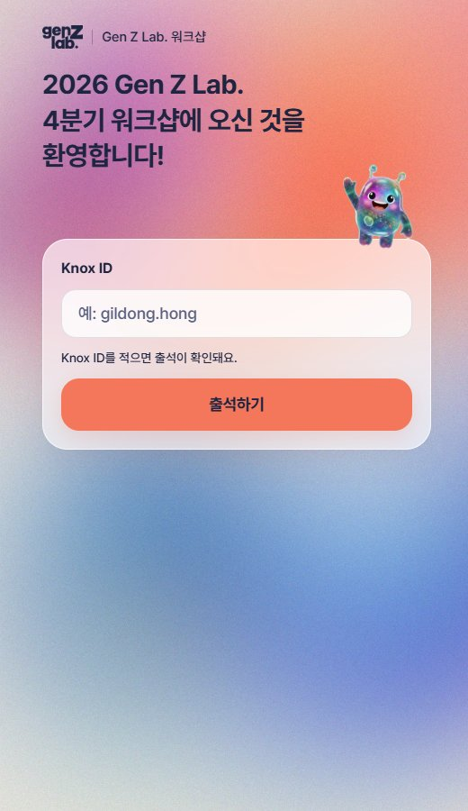
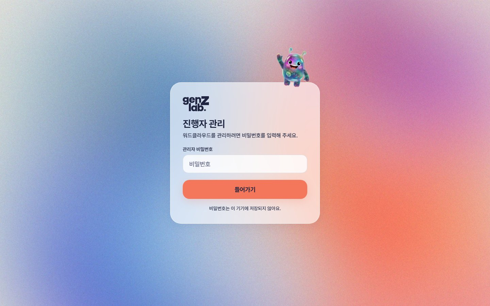
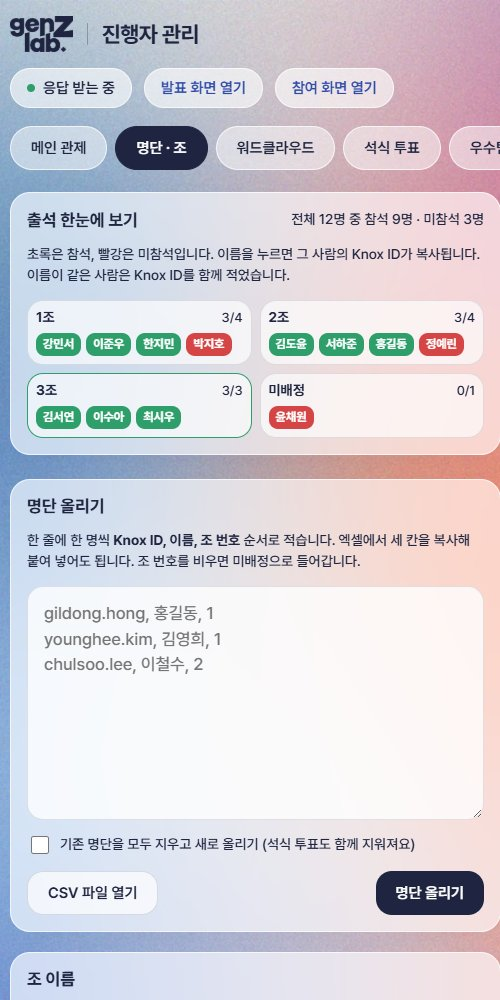
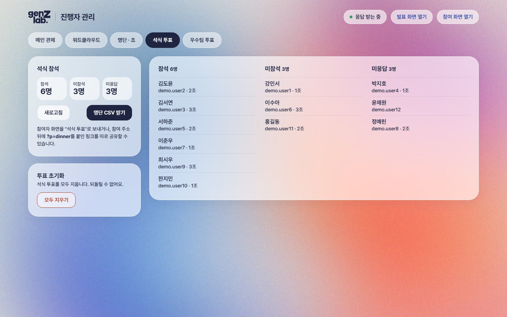
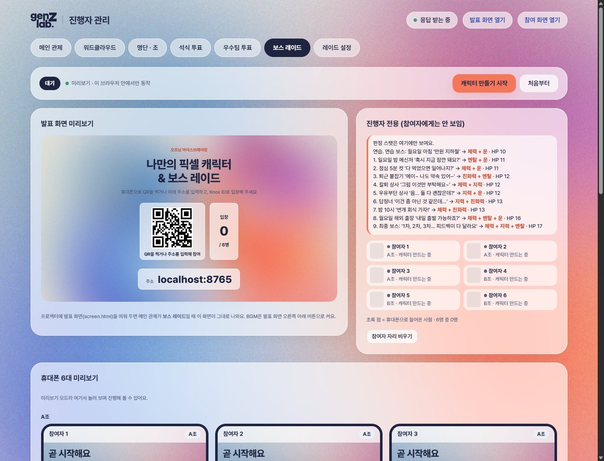
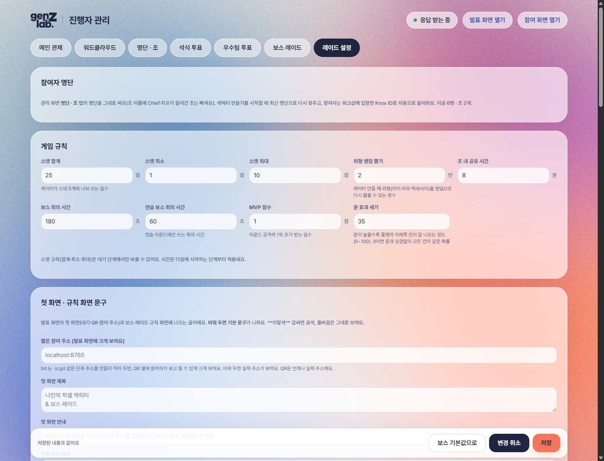
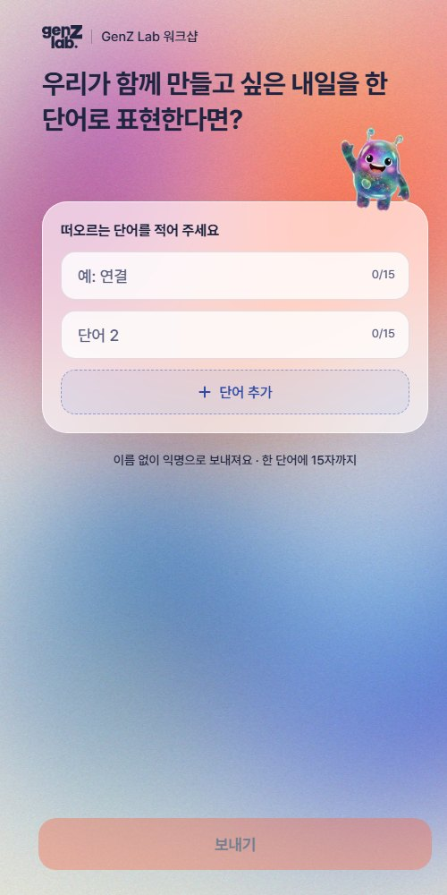
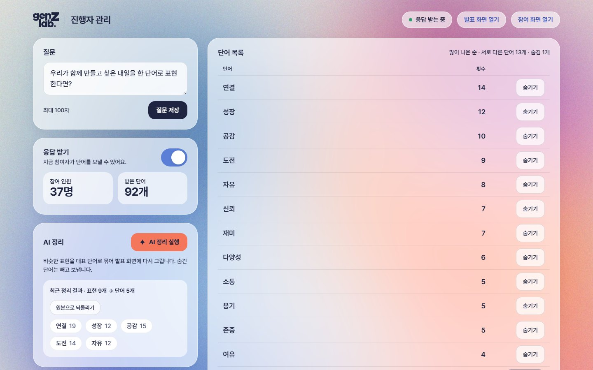

# Gen Z Lab. 26Q4 워크샵 플랫폼

워크샵 하루를 한 사이트로 진행하는 웹앱입니다. 참여자는 Knox ID로 입장하고, 진행자가 관리 화면에서 프로그램을 바꾸면 모든 참여자의 스마트폰 화면이 그 프로그램으로 넘어갑니다.
2026년 4분기 Gen Z Lab. 워크샵용으로, 70명 안팎을 기준으로 만들었습니다. 3분기 워크샵에 쓴 [genz-lab-26Q3-workshop-platform](https://github.com/Ooohje/genz-lab-26Q3-workshop-platform)의 명단 · 조 · 관제 방식을 이어받았습니다.

저장소: <https://github.com/Ooohje/genz-lab-26Q4-workshop-platform>


## 목차

- [프로그램](#프로그램)
- [접속 주소](#접속-주소)
- [진행 흐름](#진행-흐름)
- [관리 화면](#관리-화면): 메인 관제 · 명단 · 조 · 석식 투표 · 우수팀 투표
- [보스 레이드](#보스-레이드-오프닝)
- [워드클라우드](#워드클라우드)
- [구성](#구성)
- [처음 설정하기](#처음-설정하기)
- [배포](#배포)
- [함께 작업할 때](#함께-작업할-때)
- [테스트](#테스트)
- [워크샵 당일 체크리스트](#워크샵-당일-체크리스트)
- [알아 둘 점](#알아-둘-점)

## 프로그램

| 프로그램 | 참여자 화면에서 하는 일 |
|---|---|
| 대기 | 내 조와 같은 조 사람들 확인 |
| 보스 레이드 | (오프닝) 픽셀 캐릭터 만들기 → 조 내 공유 → 연습 → 보스 레이드 → 최종 순위 |
| 워드클라우드 | 질문에 답변을 보내면 프로젝터 화면에 실시간으로 그려짐 |
| 석식 투표 | 참석 / 미참석 선택 |
| 우수팀 투표 | 발표가 가장 좋았던 조에 한 표 (본인 조 제외) |
| 마무리 | 끝인사 |

순서는 정해져 있지 않습니다. 진행자가 메인 관제에서 누르는 프로그램이 그때그때 열립니다.

## 접속 주소

| 화면 | 누가 | 주소 |
|---|---|---|
| 참여 (join) | 참여자 · 스마트폰 | <https://ooohje.github.io/genz-lab-26Q4-workshop-platform/> |
| 발표 (screen) | 프로젝터 · 전체화면(F11) | <https://ooohje.github.io/genz-lab-26Q4-workshop-platform/screen.html> |
| 관리 (admin) | 진행자 · 노트북 | <https://ooohje.github.io/genz-lab-26Q4-workshop-platform/admin.html> |

- 참여 주소는 발표 화면의 QR코드로도 열 수 있고, Knox 메신저로 링크를 공유해도 됩니다.
- 참여 주소 뒤에 `?p=dinner`나 `?p=teamvote`를 붙이면 진행 중인 프로그램과 상관없이 그 화면을 엽니다(석식 투표 링크만 따로 돌릴 때).
- `admin.html?tab=roster`처럼 열면 그 탭부터 보여 줍니다(`control`, `wordcloud`, `roster`, `dinner`, `teamvote`, `raid`, `raidcfg`).
- `admin.html?demo=1`은 서버 없이 샘플 데이터로 여는 미리보기입니다(저장되지 않음).

## 진행 흐름

1. 진행자가 관리 화면 **명단 · 조** 탭에 `Knox ID, 이름, 조 번호`를 붙여 넣어 명단을 올립니다.
2. 참여자가 참여 주소(QR, 링크, 또는 그 주소를 써 둔 NFC 태그)로 들어오면 "2026 Gen Z Lab. 4분기 워크샵에 오신 것을 환영합니다!" 화면이 나옵니다. Knox ID를 적고 **출석하기**를 누르면 출석으로 잡히고 대기 화면으로 넘어갑니다. 명단에 없는 ID는 이름을 받아 "조 미배정"으로 들어옵니다.
3. 진행자가 **메인 관제** 탭에서 프로그램을 누르면 모든 참여자 화면이 그 프로그램으로 넘어갑니다. 발표 화면은 보스 레이드일 때 레이드 화면, 그 밖에는 워드클라우드를 보여 줍니다.
4. 참여자가 오른쪽 위 자기 이름을 눌러 로그아웃하면 출석도 취소됩니다(투표한 내용은 남습니다).

### 출석 (첫 화면)

| 참여자 첫 화면 | 진행자 명단 · 조 탭 |
|---|---|
|  |  |

- 참여자가 Knox ID를 적고 **출석하기**를 누르면 그 사람이 **참석**(초록)으로 바뀝니다. 아직 오지 않은 사람은 **미참석**(빨강)입니다.
- 조 박스 안에서 참석한 사람이 위, 미참석이 아래로 모입니다.
- "전체 N명 중 참석 N명 · 미참석 N명"이 메인 관제와 명단 · 조 탭에 나옵니다. Chief Crew는 세지 않습니다.
- **출석 한눈에 보기**: 명단 · 조 탭 맨 위에 조마다 작은 칸이 있고, 이름이 초록(참석) · 빨강(미참석)으로 나옵니다. 이름을 누르면 그 사람의 Knox ID가 복사됩니다. 이름이 같은 사람은 Knox ID를 함께 적습니다.
- **출석 초기화**: 모두 미참석으로 되돌리고 열려 있던 휴대폰을 로그아웃시킵니다. 리허설 뒤 본 행사 전에 누릅니다.
- NFC 태그를 쓰려면 태그에 참여 주소를 써 두면 됩니다. 코드 쪽 설정은 없습니다.

## 관리 화면

비밀번호로 들어갑니다. 탭은 메인 관제 · 명단 · 조 · 워드클라우드 · 석식 투표 · 우수팀 투표 · 보스 레이드 · 레이드 설정입니다.



### 메인 관제

지금 진행할 프로그램을 고르고, 출석 현황을 보고, 모든 참여자 화면 위에 공지를 띄웁니다.


### 명단 · 조

조마다 박스 하나로 보입니다. 사람마다 조를 바꾸거나 지울 수 있고, 박스 맨 아래 줄에서 그 조에 사람을 추가합니다. 조 이름은 왼쪽 "조 이름"에서 눌러 바꿉니다. 조 박스 머리의 **조 삭제**를 누르면 그 조가 없어지고, 조원은 명단에 남아 "미배정"으로 옮겨지며, 그 조가 받은 우수팀 투표 표도 함께 지워집니다. 바꾼 내용은 참여자 화면에 바로 반영됩니다.

출석부로도 씁니다. Knox ID로 들어온 사람은 **참석**(초록), 아직 오지 않은 사람은 **미참석**(빨강)으로 칠해지고, 조 박스 안에서 참석한 사람이 위에 모입니다. 15초마다 새로 읽습니다. 인원은 Chief Crew(조 이름에 "Chief" · "치프"가 들어간 조)를 빼고 세며, 메인 관제와 이 탭 위쪽에 "전체 N명 중 참석 N명 · 미참석 N명"으로 나옵니다. **출석 초기화**를 누르면 모든 사람이 미참석으로 돌아가고, 열려 있던 휴대폰은 로그아웃되어 첫 화면으로 갑니다(명단 · 조 · 투표는 그대로).


맨 위 **출석 한눈에 보기**는 조마다 작은 칸 하나에 이름을 초록 · 빨강으로 보여 줍니다(Chief Crew 제외). 조 이름 옆에는 담당 CC가 적힙니다(1 · 2조 민영, 3 · 4조 수연, 5 · 6조 영석, 7 · 8조 용임, 9 · 10조 제석, 11 · 12조 수민). 담당이 바뀌면 `js/admin-platform.js`의 `TEAM_CC`를 고칩니다. 이름을 누르면 Knox ID가 복사되고, 복사가 막힌 브라우저에서는 Knox ID를 골라 둔 창이 뜹니다. 이름이 같은 사람은 Knox ID가 함께 적힙니다.

### 휴대폰에서 보는 관리 화면

관리 화면은 휴대폰에서도 쓸 수 있습니다. 탭은 한 줄에서 옆으로 밀고, 명단은 한 사람이 두 줄(이름 · Knox ID · 출석 / 조 고르기 · 삭제)로 나옵니다. 지우기 · 초기화 같은 확인창은 브라우저 기본 창이 아니라 화면 안에 뜨므로, 앱 안 브라우저처럼 기본 창이 막힌 곳에서도 동작합니다.



### 석식 투표

참여자는 참석이나 미참석을 고르고 **확인**을 눌러 저장합니다. 저장 뒤에는 완료 화면이 나오고 **다시 바꾸기**로 고칠 수 있습니다. 관리 화면에는 참석 · 미참석 · 미응답 인원과 이름 · Knox ID · 조가 나오고, CSV로 받을 수 있습니다.



### 발표 우수팀 투표

참여자에게는 본인 조를 뺀 조가 버튼으로 뜨고, 한 사람이 한 표를 냅니다. 본인 조 제외는 서버에서도 막습니다. 발표하지 않는 조(예: Chief Crew)는 **후보에서 빼기**로 뺄 수 있고, 그 조 사람들은 모든 후보 조에 투표할 수 있습니다. 관리 화면에는 조별 득표가 많이 받은 순으로 나옵니다.


## 보스 레이드 (오프닝)

픽셀 캐릭터를 만들고, 조별로 출전자를 골라 보스를 잡는 오프닝 게임입니다. 플랫폼 안의 기능이라 따로 열 페이지나 비밀번호가 없습니다.



### 어디서 무엇을 하나

| 화면 | 하는 일 |
|---|---|
| 관리 · **보스 레이드** 탭 | 진행: 단계 버튼, 발표 화면 미리보기, 판정표 · 누적 점수, 입장 현황 |
| 관리 · **레이드 설정** 탭 | 설정: 규칙, 첫 화면 · 규칙 화면 문구, 연습 보스, 돌발 이벤트 룰렛, 보스 |
| 참여 화면 | 메인 관제가 **보스 레이드**이면 그 자리에서 레이드로 바뀌고, 입장한 **Knox ID로 자동으로** 자기 자리에 들어감 |
| 발표 화면 | 메인 관제가 **보스 레이드**이면 워드클라우드 대신 레이드를 보여 주고, 다른 프로그램을 누르면 돌아옴 |

명단은 **명단 · 조** 탭의 것을 그대로 씁니다(조 이름에 "Chief" · "치프"가 들어간 조는 빠짐). 캐릭터 만들기를 시작할 때 최신 명단으로 다시 맞춥니다.

### 진행 순서

1. 메인 관제에서 **보스 레이드** → 보스 레이드 탭 (처음이면 **게임 준비하기**) → 발표 화면에 QR, 참여 주소(레이드 설정의 **짧은 참여 주소**, 비우면 실제 주소), 입장 인원.
2. **캐릭터 만들기**: 스탯 5개(체력 · 지력 · 친화력 · 멘탈 · 운)에 25점을 나눕니다(스탯 하나 1~10점). 옷 · 소품 · 표정은 스탯으로 정해지고, 머리 · 피부 · 액세서리는 **외형 랜덤 뽑기**로 2번 다시 뽑을 수 있습니다.
3. **조 내 공유**: 휴대폰에 우리 조 캐릭터 카드, 발표 화면에 소개 질문 3개 (타이머 없음, 진행자가 넘김).
4. **보스 레이드 규칙** → **연습 보스 1 시작** → **연습 보스 2 시작**(점수는 본게임처럼 계산해 보여 주고 연습 2 뒤엔 연습 합계도 나오지만 실제 총점 · 출전 기록에는 안 들어감, 룰렛은 기본으로 연습 2에만, 타이머 없이 진행자가 마감) 또는 **연습 없이 1번 보스 시작**.
5. 라운드마다 **회의**(회의 타이머는 본게임 보스에만. 조원과 판정 스탯을 추리해 출전자 1명 고르기) → **마감하기** → (돌발 이벤트면) **룰렛 돌리기** → **결과 공개**.
6. 마지막 보스 뒤 **최종 순위**. 누적 점수와 순위는 중간 집계와 이때 발표 화면 · 휴대폰에 공개됩니다.

결과 화면은 세 장입니다.

1. **공격력**: 출전자 캐릭터, 공격력 게이지, 판정 스탯(룰렛으로 바뀐 값은 보라색) → **점수표 보기**
2. **점수표**: 격파 성공 · 실패 조 수와 조마다 이번 라운드에 얻은 점수(격파 보상 · MVP · 룰렛) → **중간 집계 보기**
3. **중간 집계**: 지금까지 조별 총점 순위(휴대폰에도 나옴). 3 · 6 · 9라운드에는 점수표 다음에 중간 집계를 먼저 권하고, 다른 라운드에서도 언제든 띄울 수 있습니다.

### 규칙

- **판정**: 공격력 = 출전자의 판정 스탯 합(+룰렛). 보스 HP 이상이면 격파 → 보상 점수. 라운드 공격력 1위 조는 MVP +1점.
- **출전 횟수**: 한 사람은 최대 2번 출전합니다(조원 6명 미만인 조는 3번).
- **판정 스탯**: 결과 공개 전까지 진행자 화면에만 있습니다. 결과 공개 때 출전자 밑에 값(예: 체력 6 + 멘탈 5)이 나옵니다.
- **돌발 이벤트**: 회의 중에 알려 주지 않고, 마감 뒤 "!! 돌발 이벤트 발생 !!"과 함께 글자 룰렛이 돕니다. 칸(공격력 ±N · 격파하면 +N점 · 실패 시 +N점 · 효과 없음)은 설정 탭에서 정하고, 운이 높을수록 아래쪽 칸이 잘 나옵니다.
- **AI 서술**: Gemini가 출전자마다 이긴 이유 · 진 이유를 그 사람의 스탯과 엮어 한두 문장으로 씁니다. 판정은 스탯으로 이미 끝났고 AI는 설명만 씁니다. 회의 중 출전자가 정해진 조는 미리 써 두고(진행자에게만 보관), 마감 때 출전자 · 격파 여부가 같으면 그대로 써서 결과 공개 때 바로 보입니다. 바뀐 조만 마감 뒤 새로 씁니다. 휴대폰 결과 카드에는 우리 조 서술이, 보스 레이드 탭 판정표 아래에는 모든 조 서술이 나오고, 마음에 안 들면 **다시 만들기**를 누릅니다. 키는 워드클라우드 AI 정리와 같은 `GEMINI_API_KEY`입니다.
- **되돌리기**: 진행자 화면의 **← 이전 단계**로 한 단계 전으로 돌아갑니다. **처음부터**는 캐릭터 · 결과를 지우고 대기로 갑니다.
- **BGM**: 관리 화면 보스 레이드 탭의 **♪ 발표 화면 BGM 켜기/끄기**로 켜고 끕니다. 단계마다 곡이 바뀝니다. 브라우저 정책상 발표 화면 페이지를 한 번은 클릭해야 소리가 나요(그 전에는 발표 화면 오른쪽 아래에 안내가 뜨고, 아무 데나 한 번 클릭하면 나옵니다). 곡은 `js/raid-sim-bgm.js`에서 코드로 직접 작곡한 칩튠이라 저작권 문제가 없습니다.

### 레이드 설정



**저장**을 누르면 모든 화면에 바로 적용됩니다.

- **보스** (1~20명): 이름, 설명, HP, 보상, 판정 스탯, 돌발 이벤트, 힌트, 결과 설명
- **규칙**: 스탯 합계 · 최소 · 최대, 외형 랜덤 뽑기 횟수, 보스 회의 시간, MVP 점수, 운 효과 세기
- **문구**: 짧은 참여 주소, 첫 화면 · 규칙 화면 문구
- **연습 보스 2명**과 **룰렛 칸**

### 미리 해 보기와 새로 올릴 때

- **미리 해 보기**: `admin.html?demo=1`의 보스 레이드 탭은 서버 없이 그 브라우저 안에서 6명으로 끝까지 해 볼 수 있습니다(아래쪽에 휴대폰 6대 미리보기).
- **새로 올릴 때**: 플랫폼 파일(css/style.css, js/app.js 등)을 고쳤으면 index · admin · screen.html의 `?p=` 숫자를 바꿉니다. 보스 레이드는 `js/raid.js` 맨 위 `V`와 index · admin · screen.html의 `?v=` 숫자를 같이 바꾸면, 이미 열려 있던 브라우저도 캐시 대신 새 파일을 받습니다(GitHub Pages는 10분 캐시).

## 워드클라우드

| 참여 | 관리 |
|---|---|
|  |  |

- **참여**: 답변은 익명으로 보내집니다(Knox ID와 연결하지 않습니다). 입력칸 2개가 기본이고 "입력칸 추가"로 늘립니다(한 칸 30자, 한 사람 30개까지). 보낸 답변은 칩으로 쌓이고 계속 추가할 수 있습니다. 마감되면 입력이 닫힙니다.
- **발표**: 많이 나온 단어일수록 크고 굵게, 가운데에 놓입니다. 새 단어는 떠오르며 나타나고, 같은 단어가 또 들어오면 커지면서 살짝 튕깁니다. 아직 단어가 없으면 QR이 중앙에 크게 보입니다.
- **관리**: **워드클라우드** 탭에서 질문 변경, 응답 시작/마감, 단어 숨기기, AI 정리, 내려받기, 초기화를 합니다.

### AI 정리

관리 화면에서 **AI 정리 실행**을 누르면 흩어진 표현을 Gemini가 묶고, 발표 화면이 그 결과로 다시 그려집니다. 왼쪽 아래에 몇 개의 표현이 몇 개로 묶였는지 표시되고, **원본 보기**나 화면 아무 곳을 누르면 원래 클라우드로 돌아갑니다. `screen.html?view=ai`로 열면 정리된 화면부터 보여 줍니다.

묶음에 붙는 이름은 질문에 따라 달라집니다. AI가 질문 문장을 읽고 판단합니다.

| 질문의 종류 | 묶음 이름 | 예 |
|---|---|---|
| 한 마디 · 인사 · 감사 · 소감을 남기는 질문 | 다정한 존댓말 한 마디 (최대 15자) | 고마워요 · 감사합니다 · 덕분이에요 → **정말 고마웠어요** |
| 프로그램 · 활동 아이디어를 묻는 질문 | 프로그램 종류 이름 | 경영진과의 대화 · 임원 면담 → **임원 간담회** |
| 가치 · 키워드를 묻는 질문 | 명사형 대표 단어 | 소통 · 대화 · 이야기 나누기 → **소통** |

뜻이 없는 입력(ㅋㅋ, 테스트 등)은 정리된 화면에서 빠집니다. 규칙은 [supabase/functions/admin/index.ts](supabase/functions/admin/index.ts)의 `SYSTEM_PROMPT`에 있고, 고친 뒤에는 Edge Function을 다시 배포해야 합니다.


### 내려받기

둘 다 엑셀에서 바로 열리는 CSV이고, 맨 위에 질문이 적혀 있습니다.

- **원본 데이터 내려받기** (단어 목록 위): 받은 답변을 한 줄씩. 번호, 보낸 시각, 참여자(기기별 익명 번호), 단어, 숨김 여부
- **정리 결과 내려받기** (AI 정리 칸): 순위, 대표 표현, 횟수, 묶인 표현

### 대기 화면

아직 단어가 없을 때는 QR코드가 가운데에 크게 보입니다.


## 구성

```
index.html      참여 화면          js/app.js (입장·프로그램 전환·투표) · js/join.js (워드클라우드 입력)
screen.html     발표 화면          js/screen.js   (d3-cloud 배치)
admin.html      관리 화면          js/admin.js (워드클라우드 탭) · js/admin-platform.js (관제·명단·투표 탭)
js/common.js    세 화면이 함께 쓰는 Supabase 연결과 도우미
js/raid.js      보스 레이드        관리(보스 레이드·레이드 설정 탭)·참여·발표 화면에 Shadow DOM 으로 그림 · css/raid.css
                                  js/raid-sim-engine.js (미리보기 모드 규칙) · js/raid-sim-bgm.js (BGM)
config.js       Supabase 주소와 공개 키 (이 파일만 고치면 됩니다)
css/style.css   공통 스타일
assets/         배경, 로고, 캐릭터, 파비콘
docs/           README에 쓰는 화면 캡처
scripts/        fake-60.mjs (가짜 참여자 60명 테스트)
supabase/       아래 표
```

| supabase/ 안의 파일 | 내용 |
|---|---|
| `schema.sql` | 워드클라우드: 세션, 단어, RLS, Realtime |
| `platform.sql` | 참가자 · 조 · 프로그램 관제 · 석식 투표 |
| `teamvote.sql` | 발표 우수팀 투표 |
| `leave.sql` | 로그아웃하면 출석 취소 |
| `attendance.sql` | 출석 초기화 (모두 로그아웃) |
| `wordlen.sql` | 워드클라우드 답변 길이를 30자로 (예전 15자로 만든 프로젝트용) |
| `raid-sim.sql` | 보스 레이드: 진행 · 판정 · 점수 |
| `functions/admin` | 관리 화면의 모든 동작과 워드클라우드 AI 정리 (Edge Function) |
| `functions/raid-sim` | 보스 레이드 진행 버튼과 AI 서술 (Edge Function) |
| `SETUP.md` | 설정 순서 |

- **프론트**: 빌드 없는 정적 HTML/CSS/JS → GitHub Pages
- **백엔드**: Supabase 무료 플랜 (Postgres + Realtime + Edge Function)
- **AI**: Gemini API 무료 구간. 키는 Supabase secrets에만 있고 Edge Function에서만 호출합니다. 프론트 코드에는 없습니다.
- **개인정보**: 이름 · Knox ID · 투표 내용은 공개 키로 직접 읽을 수 없습니다. 참여자는 데이터베이스 함수로 자기 것만 읽고 쓰고, 진행자는 비밀번호를 확인하는 Edge Function으로만 봅니다.
- **단어 합치기**: 같은 단어는 공백 제거 · 소문자 기준으로 합칩니다(`연 결` = `연결`, `Growth` = `growth`).

## 처음 설정하기

1. **Supabase**: [supabase/SETUP.md](supabase/SETUP.md)를 위에서부터 따라 합니다. SQL은 `schema.sql` → `platform.sql` → `teamvote.sql` → `leave.sql` → `attendance.sql` → `raid-sim.sql` 순서로(15자 제한으로 만든 예전 프로젝트는 `wordlen.sql`도) 실행하고, secrets와 Edge Function(`admin`, `raid-sim`)을 넣습니다.
2. **config.js**: Project URL과 anon(publishable) 키를 넣습니다. 이 두 값은 공개되어도 됩니다.
3. **GitHub Pages**: 아래 "배포" 참고.

Secrets는 세 가지입니다. 모두 Supabase 대시보드에만 넣고 코드에는 적지 않습니다.

| 이름 | 쓰는 곳 |
|---|---|
| `ADMIN_PASSWORD` | 관리 화면 비밀번호 (보스 레이드도 같이 씀) |
| `GEMINI_API_KEY` | 워드클라우드 AI 정리, 보스 레이드 AI 서술 |
| `RAID_SIM_PASSWORD` (선택) | 보스 레이드 진행 비밀번호를 따로 두고 싶을 때 |

## 배포

### 화면 (HTML · CSS · JS)

이 저장소는 `gh-pages` 브랜치를 GitHub Pages로 내보냅니다. 고친 뒤 두 브랜치에 모두 올리면 1~2분 안에 반영됩니다.

```bash
git add -A
```

```bash
git commit -m "변경 내용"
```

```bash
git push origin main
```

```bash
git push origin main:gh-pages
```

Pages 설정을 바꾸려면 저장소 **Settings → Pages**에서 Source를 "Deploy from a branch", 브랜치를 `gh-pages` / `(root)`로 둡니다.

### 서버 (Edge Function · SQL)

GitHub에 올리는 것만으로는 반영되지 않습니다. Supabase 대시보드에서 직접 해야 합니다.

| 고친 파일 | 해야 할 일 |
|---|---|
| `supabase/functions/admin/index.ts` | **Edge Functions → admin → Code**에 새 코드를 붙여 넣고 Deploy |
| `supabase/functions/raid-sim/index.ts` | **Edge Functions → raid-sim → Code**에 새 코드를 붙여 넣고 Deploy |
| `supabase/*.sql` | **SQL Editor**에 그 파일을 통째로 붙여 넣고 Run (여러 번 실행해도 안전) |

함수가 이전 코드이면 메인 관제에서 "알 수 없는 프로그램입니다", 보스 레이드 탭에서 "알 수 없는 동작"이 뜹니다.

## 함께 작업할 때

- **Collaborator는 `main`과 `gh-pages`에 바로 올릴 수 있습니다.** `gh-pages`에 올리면 곧바로 실제 사이트에 나갑니다. 확인을 거치고 싶으면 저장소 **Settings → Rules → Rulesets**에서 두 브랜치에 "Require a pull request before merging"을 켭니다.
- **클론한 코드는 실제 DB를 바라봅니다.** `config.js`에 운영 프로젝트의 주소와 공개 키가 들어 있어서, 내 컴퓨터에서 띄워도 단어와 투표가 실제 DB에 쌓입니다. 화면만 볼 때는 `admin.html?demo=1`을 쓰고, 테스트로 넣은 데이터는 지웁니다.
- **올리기 전에 최신 내용을 받습니다.** 다른 사람이 먼저 올렸으면 push가 거부됩니다.

```bash
git pull origin main
```

- **Edge Function이나 SQL을 고쳤으면 알립니다.** Supabase 대시보드 권한이 있는 사람이 다시 배포해야 반영됩니다.

## 테스트

### 가짜 참여자 60명

Node 18 이상이면 설치 없이 실행됩니다. 발표 화면을 띄워 놓고 돌리면 단어가 쌓이는 모습을 볼 수 있습니다.

```bash
node scripts/fake-60.mjs
```

```bash
node scripts/fake-60.mjs --people 30 --seconds 15
```

실제 DB에 단어가 들어갑니다. 끝나면 관리 화면의 **모두 지우기**로 지우세요.

### 서버 없이 미리보기

`admin.html?demo=1`을 엽니다. 샘플 데이터로 모든 탭을 눌러 볼 수 있고, 보스 레이드는 6명으로 끝까지 해 볼 수 있습니다. 저장되지 않습니다.

## 워크샵 당일 체크리스트

**전날**

- [ ] Supabase 대시보드에 들어가 프로젝트가 **깨어 있는지** 확인 (무료 플랜은 7일간 사용이 없으면 일시정지됩니다. "Restore"를 누르면 몇 분 걸립니다)
- [ ] 관리 화면에 비밀번호로 들어가지는지 확인
- [ ] **명단 · 조** 탭에 명단이 맞게 올라가 있는지, 조별 인원이 맞는지 확인
- [ ] **메인 관제**에서 프로그램을 하나씩 눌러 스마트폰 화면이 따라 넘어가는지 확인하고 "대기"로 되돌리기
- [ ] 테스트로 넣은 석식 투표와 우수팀 투표는 각 탭의 **모두 지우기**로 삭제
- [ ] 관리 화면 **보스 레이드** 탭에서 입장 현황이 워크샵 명단과 맞는지, 메인 관제 **보스 레이드** 때 휴대폰 한 대가 자동으로 들어가는지 확인 → **처음부터**
- [ ] `node scripts/fake-60.mjs`로 발표 화면에 단어가 쌓이는지 확인
- [ ] **AI 정리 실행**을 한 번 눌러 결과가 나오는지 확인
- [ ] [AI Studio 한도 페이지](https://aistudio.google.com/rate-limit)에서 **Gemini 무료 한도**가 남아 있는지 확인
- [ ] 관리 화면에서 **모두 지우기**로 테스트 단어 삭제
- [ ] 워크샵 질문을 입력하고 저장

**당일, 시작 전**

- [ ] 행사장 네트워크(와이파이 · 사내망)에서 세 화면이 모두 열리는지 확인. `supabase.co`, `github.io`, `cdn.jsdelivr.net`이 막혀 있으면 동작하지 않습니다
- [ ] 스마트폰 한 대로 QR을 찍어 단어 하나를 보내 보고, 발표 화면에 뜨면 **모두 지우기**
- [ ] 프로젝터에 발표 화면을 띄우고 F11로 전체화면 (보스 레이드 때는 자동으로 레이드 화면으로 바뀝니다. 발표 화면을 아무 데나 한 번 클릭해 두면 관리 화면에서 BGM을 켤 수 있어요)
- [ ] 관리 화면은 진행자 노트북에 따로 열어 두기 (프로젝터에 비밀번호가 비치지 않게)
- [ ] 리허설로 들어온 사람이 있으면 명단 · 조 탭에서 **출석 초기화**
- [ ] 응답 받기가 **켜져** 있는지, 메인 관제가 **대기**인지 확인
- [ ] Knox 메신저에 참여 링크 공유

**진행 중**

- 프로그램을 바꿀 때는 **메인 관제**에서 누르기만 하면 됩니다
- 명단에 없이 들어온 사람은 **명단 · 조** 탭의 "미배정" 박스에서 조를 골라 줍니다
- 부적절한 단어는 관리 화면 단어 목록에서 **숨기기**
- 충분히 모이면 **응답 받기**를 끄고 **AI 정리 실행**
- 다음 질문으로 넘어갈 때: (필요하면 내려받기) → 모두 지우기 → 질문 저장 → 응답 받기 켜기

**끝난 뒤**

- 워드클라우드 **원본 데이터**와 **정리 결과**, 석식 투표 CSV를 내려받아 보관
- Supabase 조직에 초대한 멤버와 저장소 Collaborator 권한 정리

**문제가 생기면**

| 증상 | 확인할 것 |
|---|---|
| 발표 화면에 새 단어가 안 뜸 | 새로고침. 20초마다 자동으로 다시 맞추므로 잠시 기다려도 됩니다 |
| "세션을 불러오지 못했어요" | Supabase 프로젝트가 일시정지됐는지, `config.js` 값이 맞는지 |
| 참여자가 "보내지 못했어요" | 응답 받기가 꺼져 있는지, 한 사람 30개 한도를 넘었는지 |
| 메인 관제에서 "알 수 없는 프로그램입니다" | Edge Function `admin`을 최신 코드로 다시 배포 |
| 참여자 화면이 프로그램을 안 따라옴 | 화면을 껐다 켜거나 새로고침 |
| 보스 레이드에서 "명단에서 찾지 못했어요" | 명단 · 조 탭에서 조가 배정됐는지 확인. 캐릭터 만들기를 시작할 때 명단을 다시 맞추고, 그 뒤 들어온 사람은 보스 레이드 탭의 **처음부터** 후 다시 시작해야 반영 |
| 보스 레이드 탭 버튼에서 "알 수 없는 동작" | Edge Function `raid-sim`을 최신 코드로 다시 배포 |
| AI 정리 실패 | 관리 화면에 뜨는 오류 문구 확인. "high demand"(503)나 한도 초과면 잠시 뒤 다시 실행 |

## 알아 둘 점

- 숨긴 단어는 화면에서 걸러서 안 보이게 하는 방식이라, 공개 키로 API를 직접 호출하면 조회됩니다.
- Knox ID는 비밀번호 없이 적기만 하면 입장됩니다. 다른 사람의 ID를 적으면 그 사람으로 투표할 수 있으니, 결과가 이상하면 관리 화면에서 확인하세요.
- 워드클라우드의 참여 인원은 브라우저마다 만든 임의 번호로 셉니다. 같은 사람이 다른 브라우저로 들어오면 두 명으로 세어집니다.
- 관리자 비밀번호는 Supabase secrets의 `ADMIN_PASSWORD`입니다. 바꾸려면 대시보드에서 값을 바꾸면 되고, 바꾸는 즉시 예전 비밀번호는 통하지 않습니다.
- Supabase 대시보드 권한이 있는 사람은 관리자 비밀번호 없이도 명단과 투표를 표에서 직접 볼 수 있습니다.
