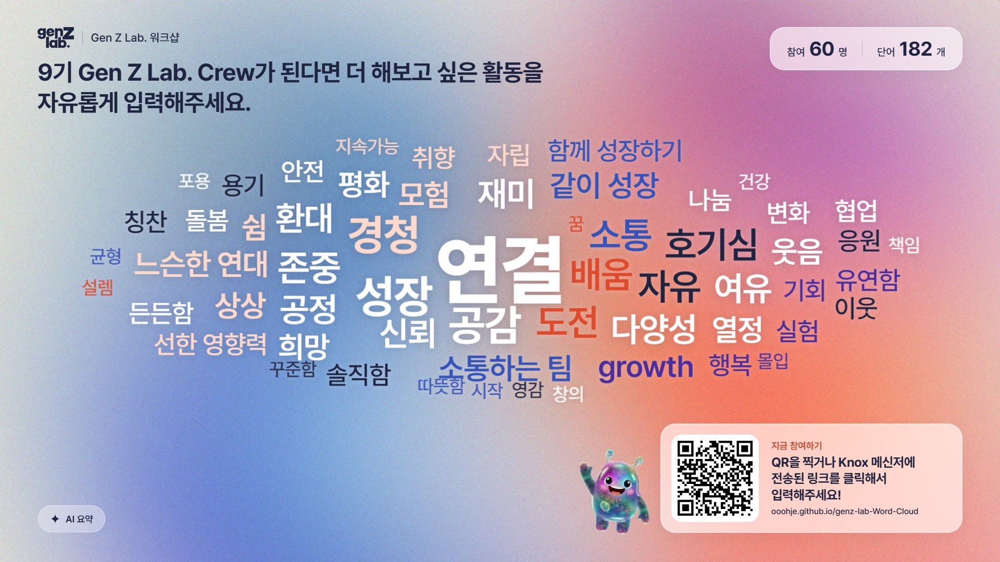
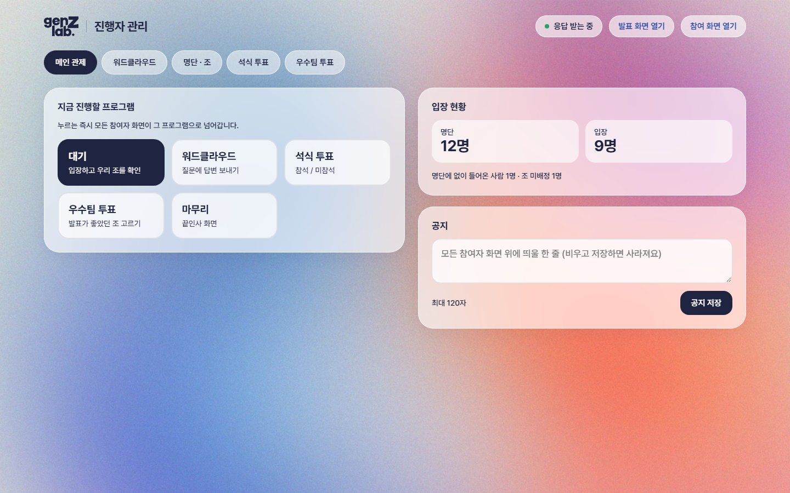
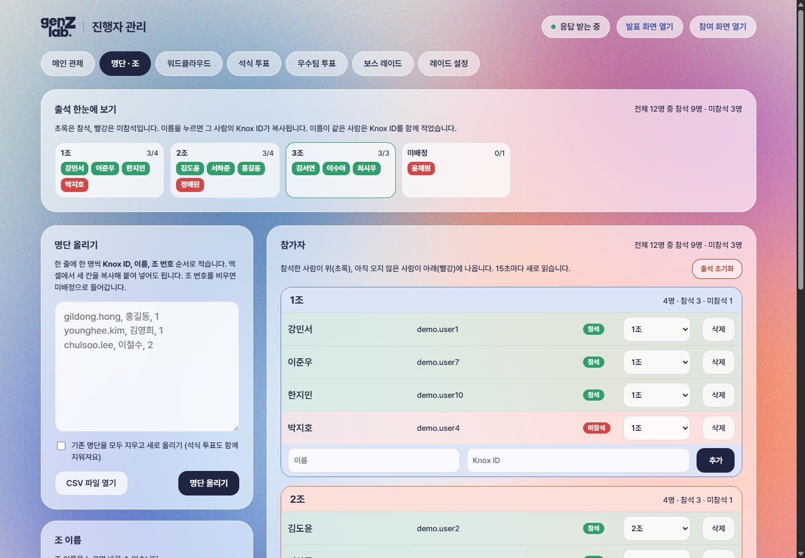
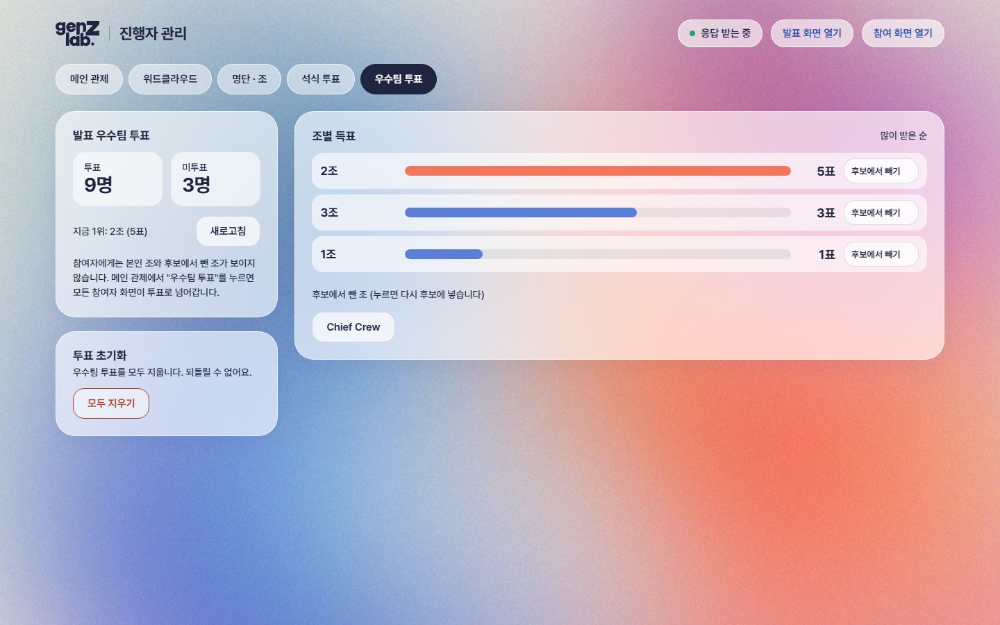
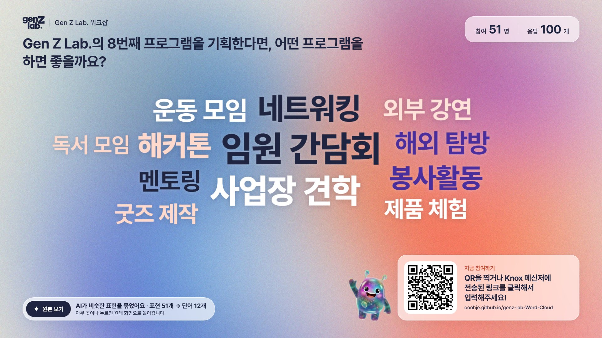
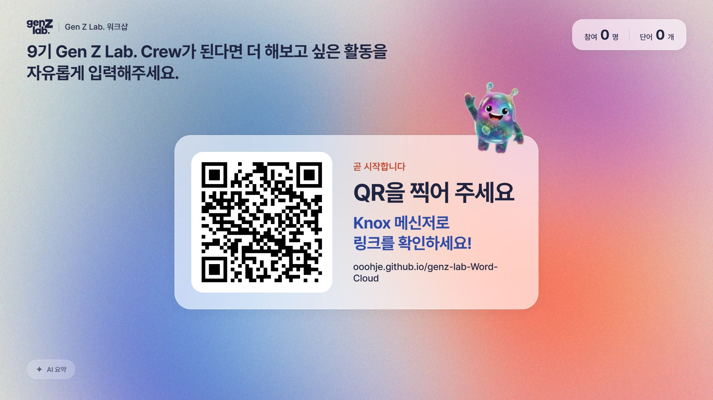

# Gen Z Lab. 26Q4 워크샵 플랫폼

워크샵 하루를 한 사이트로 진행하는 웹앱입니다. 참여자는 Knox ID로 입장하고, 진행자가 관리 화면에서 프로그램을 바꾸면 모든 참여자의 스마트폰 화면이 그 프로그램으로 넘어갑니다.
2026년 4분기 Gen Z Lab. 워크샵용으로, 70명 안팎을 기준으로 만들었습니다. 3분기 워크샵에 쓴 [genz-lab-26Q3-workshop-platform](https://github.com/Ooohje/genz-lab-26Q3-workshop-platform)의 명단 · 조 · 관제 방식을 이어받았습니다.

저장소: <https://github.com/Ooohje/genz-lab-26Q4-workshop-platform>

| 프로그램 | 참여자 화면에서 하는 일 |
|---|---|
| 대기 | 내 조와 같은 조 사람들 확인 |
| 워드클라우드 | 질문에 답변을 보내면 프로젝터 화면에 실시간으로 그려짐 |
| 석식 투표 | 참석 / 미참석 선택 |
| 우수팀 투표 | 발표가 가장 좋았던 조에 한 표 (본인 조 제외) |
| 보스 레이드 | (오프닝) 픽셀 캐릭터 만들기 → 조 내 공유 → 연습 → 보스 레이드 → 최종 순위 |
| 마무리 | 끝인사 |



## 접속 주소

| 화면 | 누가 | 주소 |
|---|---|---|
| 참여 (join) | 참여자 · 스마트폰 | <https://ooohje.github.io/genz-lab-26Q4-workshop-platform/> |
| 발표 (screen) | 프로젝터 · 전체화면(F11) | <https://ooohje.github.io/genz-lab-26Q4-workshop-platform/screen.html> |
| 관리 (admin) | 진행자 · 노트북 | <https://ooohje.github.io/genz-lab-26Q4-workshop-platform/admin.html> |
| 보스 레이드 진행 | 진행자 · 노트북 (오프닝) | <https://ooohje.github.io/genz-lab-26Q4-workshop-platform/raid-sim.html> |

참여 주소는 발표 화면의 QR코드로도 열 수 있고, Knox 메신저로 링크를 공유해도 됩니다.
참여 주소 뒤에 `?p=dinner`나 `?p=teamvote`를 붙이면 진행 중인 프로그램과 상관없이 그 화면을 엽니다(석식 투표 링크만 따로 돌릴 때).

## 진행 흐름

1. 진행자가 관리 화면 **명단 · 조** 탭에 `Knox ID, 이름, 조 번호`를 붙여 넣어 명단을 올립니다.
2. 참여자가 참여 주소에 들어와 Knox ID를 적고 입장합니다. 명단에 없는 ID는 이름을 받아 "조 미배정"으로 들어옵니다.
3. 진행자가 **메인 관제** 탭에서 프로그램을 누르면 모든 참여자 화면이 그 프로그램으로 넘어갑니다.

### 메인 관제

지금 진행할 프로그램을 고르고, 입장 현황을 보고, 모든 참여자 화면 위에 공지를 띄웁니다.



### 명단 · 조

조마다 박스 하나로 보입니다. 사람마다 조를 바꾸거나 지울 수 있고, 박스 맨 아래 줄에서 그 조에 사람을 추가합니다. 조 이름은 왼쪽 "조 이름"에서 눌러 바꿉니다. 바꾼 내용은 참여자 화면에 바로 반영됩니다.



### 석식 투표

참여자는 참석이나 미참석을 고르고 **확인**을 눌러 저장합니다. 저장 뒤에는 완료 화면이 나오고 **다시 바꾸기**로 고칠 수 있습니다. 관리 화면에는 참석 · 미참석 · 미응답 인원과 이름 · Knox ID · 조가 나오고, CSV로 받을 수 있습니다.


### 발표 우수팀 투표

참여자에게는 본인 조를 뺀 조가 버튼으로 뜨고, 한 사람이 한 표를 냅니다. 본인 조 제외는 서버에서도 막습니다. 발표하지 않는 조(예: Chief Crew)는 **후보에서 빼기**로 뺄 수 있고, 그 조 사람들은 모든 후보 조에 투표할 수 있습니다. 관리 화면에는 조별 득표가 많이 받은 순으로 나옵니다.



`admin.html?tab=roster`처럼 열면 그 탭부터 보여 줍니다(`control`, `wordcloud`, `roster`, `dinner`, `teamvote`).

## 오프닝: 픽셀 캐릭터 & 보스 레이드

메인 관제에서 **보스 레이드**를 누르면 참여자 휴대폰과 발표 화면이 보스 레이드 화면(`raid-sim.html`)으로 넘어가고, 다른 프로그램을 누르면 원래 화면으로 돌아옵니다.
참여자는 워크샵에 입장한 **Knox ID로 자동 입장**하고, 이름과 조는 **명단 · 조** 탭의 명단을 그대로 씁니다(조 이름에 "Chief"·"치프"가 들어간 조는 빠짐).
진행은 노트북에서 **보스 레이드 진행**(관리 화면 위쪽 링크, `raid-sim.html`)을 열어 관리자 비밀번호로 로그인한 뒤 버튼을 누르는 순서대로 합니다.

1. **게임 준비하기** → 워크샵 명단으로 판이 만들어집니다(명단을 바꿨으면 설정 탭의 **워크샵 명단으로 다시 맞추기**).
2. **캐릭터 만들기**: 스탯 5개(체력·지력·친화력·멘탈·운)에 25점을 나눕니다(스탯 하나 1~10점). 외형은 스탯으로 정해지고 다시 뽑기 2번.
3. **조 내 공유**: 휴대폰에 우리 조 캐릭터 카드, 발표 화면에 소개 질문 3개와 타이머.
4. **보스 레이드 규칙** → **연습 보스 시작**(점수·출전 기록에 안 들어감, 룰렛 항상) 또는 **연습 없이 1번 보스 시작**.
5. 라운드마다 **회의**(조원과 판정 스탯을 추리해 출전자 1명 고르기) → **마감하기** → (돌발 이벤트면) **룰렛 돌리기** → **결과 공개**.
6. 마지막 보스 뒤 **최종 순위**. 누적 점수와 순위는 이때만 발표 화면·휴대폰에 공개됩니다.

- 공격력 = 출전자의 판정 스탯 합(+룰렛). **보스 HP 이상이면 격파** → 보상 점수, 라운드 공격력 1위 조는 MVP +1점. 한 사람은 한 번만 출전(모두 나갔으면 다시 가능).
- 판정 스탯은 결과 공개 전까지 진행자 화면에만 있습니다. 결과 공개 때 출전자 밑에 판정 스탯 값(예: 체력 6 + 멘탈 5)이 나옵니다.
- **돌발 이벤트**는 회의 중에 알려 주지 않고, 마감 뒤 "!! 돌발 이벤트 발생 !!"과 함께 글자 룰렛이 돕니다. 칸(공격력 ±N · 격파하면 +N점 · 실패해도 +N점 · 효과 없음)은 설정 탭에서 정하고, 운이 높을수록 아래쪽 칸이 잘 나옵니다.
- 진행자 화면의 **← 이전 단계**로 한 단계 전으로 돌아갈 수 있습니다. **처음부터**는 캐릭터·결과를 지우고 대기로.
- **BGM**: 발표 화면 오른쪽 아래(또는 진행자 화면의 발표 화면 제목 옆) **♪ BGM 켜기**를 한 번 눌러야 나옵니다(브라우저 정책). 곡은 `js/raid-sim-bgm.js`에서 코드로 직접 작곡한 칩튠이라 저작권 문제가 없습니다. 발표 화면이 보스 레이드로 넘어올 때마다 한 번씩 다시 눌러 주세요.
- **보스·규칙 설정 탭**(진행자 화면 위쪽): 보스(이름·설명·HP·보상·판정 스탯·돌발 이벤트·힌트·결과 설명, 1~10명), 규칙(스탯 합계·최소·최대, 다시 뽑기, 공유·회의 시간, MVP 점수, 운 효과 세기), 첫 화면·규칙 화면 문구, 연습 보스, 룰렛 칸, 명단.
- **연습 모드**: `raid-sim.html?local`로 열면 서버 없이 그 브라우저 안에서 6명(또는 명단)으로 끝까지 해 볼 수 있습니다(아래쪽에 휴대폰 미리보기).

## 워드클라우드

| 참여 | 관리 |
|---|---|
|  |  |

- **참여**: 답변은 익명으로 보내집니다(Knox ID와 연결하지 않습니다). 입력칸 2개가 기본이고 "입력칸 추가"로 늘립니다(한 칸 15자, 한 사람 30개까지). 보낸 답변은 칩으로 쌓이고 계속 추가할 수 있습니다. 마감되면 입력이 닫힙니다.
- **발표**: 많이 나온 단어일수록 크고 굵게, 가운데에 놓입니다. 새 단어는 떠오르며 나타나고, 같은 단어가 또 들어오면 커지면서 살짝 튕깁니다. 아직 단어가 없으면 QR이 중앙에 크게 보입니다.
- **AI 정리**: 관리 화면에서 실행하면 "소통·이야기 나누기·대화"처럼 흩어진 표현을 Gemini가 대표 단어로 묶고, 발표 화면이 그 단어들로 다시 그려집니다. 화면 아무 곳이나 누르면 원본으로 돌아가고, 왼쪽 아래 ✦ 버튼으로 다시 볼 수 있습니다.
- **관리**: 비밀번호로 들어가 **워드클라우드** 탭에서 질문 변경, 응답 시작/마감, 단어 숨기기, AI 정리, 초기화를 합니다.

### AI 정리 후 (요약된 버전)

관리 화면에서 **AI 정리 실행**을 누르면 발표 화면이 대표 단어들로 다시 그려집니다. 왼쪽 아래에 몇 개의 표현이 몇 개의 단어로 묶였는지 표시되고, **원본 보기**나 화면 아무 곳을 누르면 원래 클라우드로 돌아갑니다. `screen.html?view=ai`로 열면 정리된 화면부터 보여 줍니다.



### 대기 화면

아직 단어가 없을 때는 QR코드가 가운데에 크게 보입니다.



### 관리자 로그인


## 구성

```
index.html      참여 화면          js/app.js (입장·프로그램 전환·투표) · js/join.js (워드클라우드 입력)
screen.html     발표 화면          js/screen.js   (d3-cloud 배치)
admin.html      관리 화면          js/admin.js (워드클라우드 탭) · js/admin-platform.js (관제·명단·투표 탭)
raid-sim.html   보스 레이드        진행자(기본) · #screen 발표 화면 · #join 참여자. js/raid-sim-engine.js (연습 모드 규칙) · js/raid-sim-bgm.js (BGM)
config.js       Supabase 주소와 공개 키 (이 파일만 고치면 됩니다)
css/style.css   공통 스타일
assets/         배경, 로고, 캐릭터, 파비콘
supabase/       schema.sql · platform.sql · teamvote.sql · raid-sim.sql · functions/admin · functions/raid-sim · SETUP.md
scripts/        fake-60.mjs (가짜 참여자 60명 테스트)
```

- 프론트: 빌드 없는 정적 HTML/CSS/JS → GitHub Pages
- 백엔드: Supabase 무료 플랜 (Postgres + Realtime + Edge Function)
- AI: Gemini API 무료 구간. 키는 Supabase secrets에만 있고 Edge Function에서만 호출합니다. 프론트 코드에는 없습니다.
- 이름·Knox ID·투표 내용은 공개 키로 직접 읽을 수 없습니다. 참여자는 데이터베이스 함수로 자기 것만 읽고 쓰고, 진행자는 비밀번호를 확인하는 Edge Function(`admin`)으로만 봅니다.
- 같은 단어는 공백 제거·소문자 기준으로 합칩니다(`연 결` = `연결`, `Growth` = `growth`).

## 처음 설정하기

1. **Supabase**: [supabase/SETUP.md](supabase/SETUP.md)를 위에서부터 따라 합니다. SQL은 `schema.sql` → `platform.sql` → `teamvote.sql` → `raid-sim.sql` 순서로 실행하고, secrets와 Edge Function(`admin`, `raid-sim`)을 넣습니다.
2. **config.js**: Project URL과 anon(publishable) 키를 넣습니다. 이 두 값은 공개되어도 됩니다.
3. **GitHub Pages**: 아래 "배포" 참고.

## 배포

이 저장소는 `gh-pages` 브랜치를 GitHub Pages로 내보냅니다. 고친 뒤 두 브랜치에 모두 올리면 1~2분 안에 반영됩니다.

```bash
git add -A
```

```bash
git commit -m "변경 내용"
```

```bash
git push origin main
```

```bash
git push origin main:gh-pages
```

Pages 설정을 바꾸려면 저장소 **Settings → Pages**에서 Source를 "Deploy from a branch", 브랜치를 `gh-pages` / `(root)`로 둡니다.

Edge Function(`supabase/functions/admin/index.ts`)을 고쳤을 때는 GitHub에 올리는 것만으로는 반영되지 않습니다. Supabase 대시보드 **Edge Functions → admin → Code**에 새 코드를 붙여 넣고 Deploy 해야 합니다. 붙여 넣은 코드의 `const PROGRAMS` 줄에 `"teamvote"`가 있으면 최신 코드입니다. 메인 관제에서 "알 수 없는 프로그램입니다"가 뜨면 함수가 이전 코드라는 뜻입니다.

## 테스트: 가짜 참여자 60명

Node 18 이상이면 설치 없이 실행됩니다. 발표 화면을 띄워 놓고 돌리면 단어가 쌓이는 모습을 볼 수 있습니다.

```bash
node scripts/fake-60.mjs
```

```bash
node scripts/fake-60.mjs --people 30 --seconds 15
```

실제 DB에 단어가 들어갑니다. 끝나면 관리 화면의 **모두 지우기**로 지우세요.

서버 없이 관리 화면 모양만 보려면 `admin.html?demo=1`을 엽니다(저장되지 않는 미리보기).

## 워크샵 당일 체크리스트

**전날**

- [ ] Supabase 대시보드에 들어가 프로젝트가 **깨어 있는지** 확인 (무료 플랜은 7일간 사용이 없으면 일시정지됩니다. "Restore"를 누르면 몇 분 걸립니다)
- [ ] 관리 화면에 비밀번호로 들어가지는지 확인
- [ ] **명단 · 조** 탭에 명단이 맞게 올라가 있는지, 조별 인원이 맞는지 확인
- [ ] **메인 관제**에서 프로그램을 하나씩 눌러 스마트폰 화면이 따라 넘어가는지 확인하고 "대기"로 되돌리기
- [ ] 테스트로 넣은 석식 투표와 우수팀 투표는 각 탭의 **모두 지우기**로 삭제
- [ ] **보스 레이드 진행**에 관리자 비밀번호로 들어가 **워크샵 명단으로 다시 맞추기** → 휴대폰 한 대로 자동 입장 확인 → **처음부터**
- [ ] `node scripts/fake-60.mjs`로 발표 화면에 단어가 쌓이는지 확인
- [ ] **AI 정리 실행**을 한 번 눌러 결과가 나오는지 확인
- [ ] [AI Studio 한도 페이지](https://aistudio.google.com/rate-limit)에서 **Gemini 무료 한도**가 남아 있는지 확인
- [ ] 관리 화면에서 **모두 지우기**로 테스트 단어 삭제
- [ ] 워크샵 질문을 입력하고 저장

**당일, 시작 전**

- [ ] 행사장 네트워크(와이파이·사내망)에서 세 화면이 모두 열리는지 확인. `supabase.co`, `github.io`, `cdn.jsdelivr.net`이 막혀 있으면 동작하지 않습니다
- [ ] 스마트폰 한 대로 QR을 찍어 단어 하나를 보내 보고, 발표 화면에 뜨면 **모두 지우기**
- [ ] 프로젝터에 발표 화면을 띄우고 F11로 전체화면 (보스 레이드 때는 자동으로 레이드 화면으로 바뀝니다. BGM 버튼은 그때 한 번 누르기)
- [ ] 관리 화면은 진행자 노트북에 따로 열어 두기 (프로젝터에 비밀번호가 비치지 않게)
- [ ] 응답 받기가 **켜져** 있는지, 메인 관제가 **대기**인지 확인
- [ ] Knox 메신저에 참여 링크 공유

**진행 중**

- 프로그램을 바꿀 때는 **메인 관제**에서 누르기만 하면 됩니다
- 명단에 없이 들어온 사람은 **명단 · 조** 탭의 "미배정" 박스에서 조를 골라 줍니다
- 부적절한 단어는 관리 화면 단어 목록에서 **숨기기**
- 충분히 모이면 **응답 받기**를 끄고 **AI 정리 실행**
- 다음 질문으로 넘어갈 때: 모두 지우기 → 질문 저장 → 응답 받기 켜기

**문제가 생기면**

| 증상 | 확인할 것 |
|---|---|
| 발표 화면에 새 단어가 안 뜸 | 새로고침. 20초마다 자동으로 다시 맞추므로 잠시 기다려도 됩니다 |
| "세션을 불러오지 못했어요" | Supabase 프로젝트가 일시정지됐는지, `config.js` 값이 맞는지 |
| 참여자가 "보내지 못했어요" | 응답 받기가 꺼져 있는지, 한 사람 30개 한도를 넘었는지 |
| 메인 관제에서 "알 수 없는 프로그램입니다" | Edge Function `admin`을 최신 코드로 다시 배포 |
| 참여자 화면이 프로그램을 안 따라옴 | 화면을 껐다 켜거나 새로고침 |
| 보스 레이드에서 "명단에 없는 아이디" | 명단 · 조 탭에서 조가 배정됐는지 확인 → 보스 레이드 진행 설정 탭의 **워크샵 명단으로 다시 맞추기** (대기 단계에서) |
| 보스 레이드 진행 버튼에서 "알 수 없는 동작" | Edge Function `raid-sim`을 최신 코드로 다시 배포 |
| AI 정리 실패 | 관리 화면에 뜨는 오류 문구 확인. 한도 초과면 잠시 뒤 다시 실행 |

## 알아 둘 점

- 숨긴 단어는 화면에서 걸러서 안 보이게 하는 방식이라, 익명 키로 API를 직접 호출하면 조회됩니다.
- Knox ID는 비밀번호 없이 적기만 하면 입장됩니다. 다른 사람의 ID를 적으면 그 사람으로 투표할 수 있으니, 결과가 이상하면 관리 화면에서 확인하세요.
- 워드클라우드의 참여 인원은 브라우저마다 만든 임의 번호로 셉니다. 같은 사람이 다른 브라우저로 들어오면 두 명으로 세어집니다.
- 관리자 비밀번호는 Supabase secrets의 `ADMIN_PASSWORD`입니다. 바꾸려면 대시보드에서 값을 바꾸면 됩니다.
